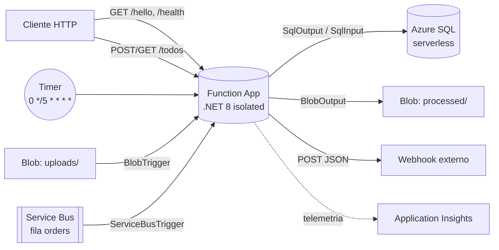

# ⚡ Serverless no Azure com Azure Functions (.NET 8)

Projeto prático do desafio da **DIO** sobre serverless no Azure, baseado no repositório do expert
[Henrique Eduardo Souza — `dio-live-function`](https://github.com/hsouzaeduardo/dio-live-function),
**reorganizado e evoluído** com configuração externa, validação, tratamento de erros, infraestrutura como código e CI/CD.


---

## 🧭 O que o projeto faz

Uma única Function App com **cinco tipos de gatilho**, cada um mostrando um padrão comum de serverless:

| Função | Gatilho | O que faz | Original |
|---|---|---|---|
| `Hello` / `Health` | HTTP | Saudação e health check | `fn-simples` |
| `Heartbeat` | Timer (CRON) | Roda a cada 5 min, agenda configurável | `fn-tempo` |
| `ProcessUploadedFile` | Blob | Arquivo em `uploads/` → relatório JSON em `processed/` | `fn-intput-blob` |
| `ForwardQueueMessage` | Service Bus | Lê a fila e encaminha o JSON para um webhook | `fn-ler-sb` |
| `CreateToDo` / `ListToDos` / `GetToDo` | HTTP + SQL bindings | API de tarefas no Azure SQL | `fn-save-sql` |



## ✨ O que melhorei em relação ao original

| Ponto | Original | Esta versão |
|---|---|---|
| Estrutura | 5 projetos separados, todos com `Function1` | 1 Function App organizada por pasta/gatilho, nomes descritivos |
| Timer | CRON `/5 * * * * * *` (7 campos, inválido) | `%TimerSchedule%` vindo da config (`0 */5 * * * *`), trata `IsPastDue` |
| Blob | Trigger **e** Input lendo o mesmo blob (redundante); saída fixa `"blob-output content"` | Só o trigger; gera relatório JSON real (linhas, palavras, preview) |
| Service Bus | Connection e URL **vazias** no código; falha usava `Defer` (mensagem fica presa) | Tudo via config; `Abandon` para retry → DLQ após `maxDeliveryCount`; erro de configuração vai direto pra DLQ; `IHttpClientFactory` com timeout |
| SQL | Só POST, sem validação, URL fixa `google.com/?id=` | POST com validação (400), GET lista e GET por id com `SqlInput` parametrizado; URL base configurável |
| Segredos | — | `local.settings.example.json` versionado, `local.settings.json` no `.gitignore` |
| Infra | Criada pelo portal/Visual Studio | **Bicep**: Flex Consumption, Storage, Service Bus, Azure SQL serverless (auto-pause), App Insights, identidade gerenciada |
| Ambiente local | — | `docker compose` com Azurite + SQL Server + criação automática da tabela |
| Entrega | Publicação manual | **GitHub Actions**: build em todo push, deploy manual sob demanda |

## 📁 Estrutura

```
.
├── src/FunctionApp/
│   ├── Http/HelloFunctions.cs
│   ├── Timer/HeartbeatFunction.cs
│   ├── Blob/ProcessUploadedFile.cs
│   ├── ServiceBus/ForwardQueueMessage.cs
│   ├── Sql/ToDoFunctions.cs, ToDoItem.cs
│   ├── Program.cs, host.json
│   └── local.settings.example.json
├── infra/main.bicep
├── sql/schema.sql
├── docker-compose.yml
├── requests.http
└── .github/workflows/ci-cd.yml
```

## 🚀 Rodando localmente

**Pré-requisitos:** [.NET 8 SDK](https://dotnet.microsoft.com/download/dotnet/8.0), [Azure Functions Core Tools v4](https://learn.microsoft.com/azure/azure-functions/functions-run-local) e Docker.

```bash
# 1. Sobe Azurite + SQL Server e cria a tabela dbo.ToDo
docker compose up -d

# 2. Configurações locais
cp src/FunctionApp/local.settings.example.json src/FunctionApp/local.settings.json

# 3. Executa
cd src/FunctionApp
func start
```

Depois é só usar o [`requests.http`](requests.http) (extensão REST Client do VS Code) ou:

```bash
curl "http://localhost:7071/api/hello?name=Heitor"
curl -X POST http://localhost:7071/api/todos -H "Content-Type: application/json" -d '{"title":"Estudar Azure Functions","order":1}'
curl http://localhost:7071/api/todos
```

**Testando o Blob Trigger:** no [Azure Storage Explorer](https://azure.microsoft.com/products/storage/storage-explorer/), conecte no emulador local, crie o container `uploads` e envie um `.txt`. O relatório aparece em `processed/<arquivo>.json`.

**Service Bus:** não há emulador no compose, então a função vem desabilitada localmente
(`AzureWebJobs.ForwardQueueMessage.Disabled = true`). Para testar, aponte `ServiceBusConnection`
para um namespace real, defina `WebhookUrl` (ex.: [webhook.site](https://webhook.site)) e mude a flag para `false`.

## ☁️ Deploy no Azure

```bash
az login
az group create -n rg-serverless-dio -l eastus2

az deployment group create -g rg-serverless-dio -f infra/main.bicep \
  -p sqlAdminLogin=sqladmin sqlAdminPassword='<SenhaForte#123>' \
     webhookUrl='https://webhook.site/<seu-id>'
```

> O plano **Flex Consumption** ainda não está disponível em todas as regiões. Confira com
> `az functionapp list-flexconsumption-locations` e escolha uma região da lista.

Depois do deploy:

1. **Criar a tabela** — no portal, abra o banco `ServerlessDb` → *Query editor* e rode [`sql/schema.sql`](sql/schema.sql)
   (libere seu IP no firewall do SQL Server se pedir).
2. **Publicar o código**:
   ```bash
   cd src/FunctionApp
   func azure functionapp publish <functionAppName>
   ```
   ou pelo GitHub Actions (abaixo).
3. **Testar** — pegue a *function key* em *Function App → Funções → App keys* e use o `requests.http` com `@base` e `@key` do Azure.
4. **Mandar uma mensagem pra fila** — no portal, *Service Bus → filas → orders → Service Bus Explorer → Send messages*, com um JSON qualquer, e veja o POST chegar no webhook.

### CI/CD com GitHub Actions

O workflow [`ci-cd.yml`](.github/workflows/ci-cd.yml) compila e publica o pacote a cada push na `main`.
Para habilitar o deploy:

1. No portal, baixe o *publish profile* da Function App (`Get publish profile`).
2. No GitHub: **Settings → Secrets and variables → Actions**
   - Secret `AZURE_FUNCTIONAPP_PUBLISH_PROFILE` = conteúdo do arquivo
   - Variable `AZURE_FUNCTIONAPP_NAME` = nome da Function App
3. **Actions → CI/CD → Run workflow** marcando `deploy`.

### 💸 Custos

Tudo foi pensado pra caber em conta de estudo: Flex Consumption cobra por execução, o Azure SQL serverless pausa
após 60 min sem uso e o Service Bus está no tier Basic. **Ao terminar, apague o resource group:**

```bash
az group delete -n rg-serverless-dio --yes --no-wait
```

## 📚 Conceitos praticados

- **Serverless / FaaS**: pagar por execução, escala automática e zero gestão de servidor.
- **Triggers e bindings**: entradas e saídas declarativas (Blob, SQL, Service Bus) sem SDK manual.
- **Modelo isolated worker** (.NET 8): o código roda num processo separado do host do Functions.
- **Mensageria confiável**: settlement manual (`Complete` / `Abandon` / `DeadLetter`) e dead-letter queue.
- **Infraestrutura como código** com Bicep e **observabilidade** com Application Insights.

## 🔗 Referências

- Repositório original do expert: <https://github.com/hsouzaeduardo/dio-live-function>
- [Documentação do Azure Functions](https://learn.microsoft.com/azure/azure-functions/)
- [Bindings de Azure SQL para Functions](https://learn.microsoft.com/azure/azure-functions/functions-bindings-azure-sql)
- [Plano Flex Consumption](https://learn.microsoft.com/azure/azure-functions/flex-consumption-plan)

---

Feito por **Heitor Araújo** — [GitHub](https://github.com/PRGHeitorAraujo) · [Portfólio](https://portfolio-three-gules-23.vercel.app/)
